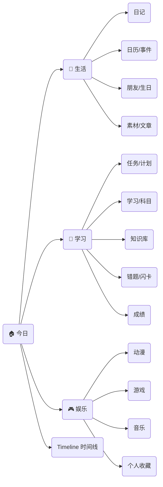
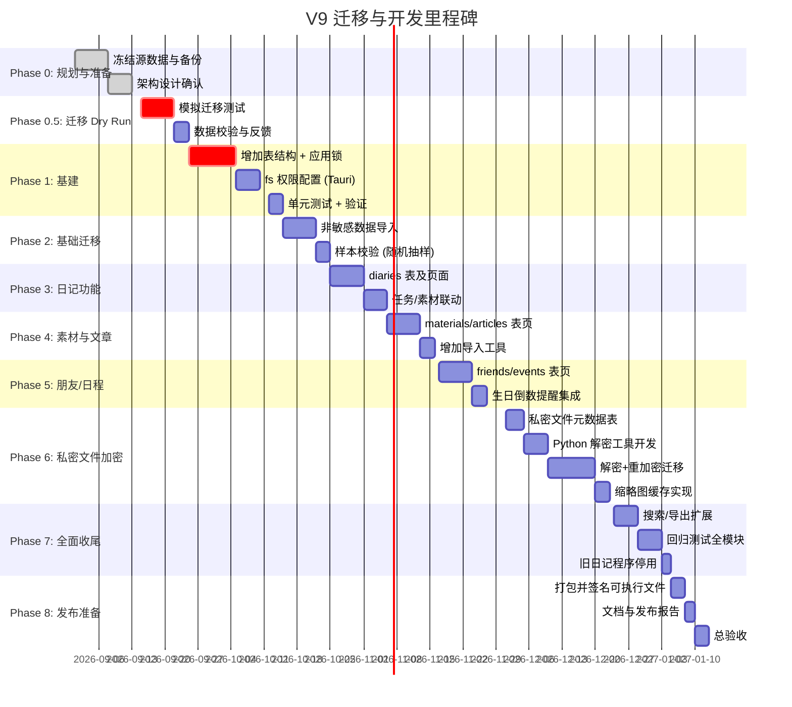

# 执行摘要

V9 的**目标**是将现有的 Workbench V8 与 MyDiary 全功能整合，升级为以「生活 (LIFE) / 学业 (WORK) / 娱乐 (PLAY)」为三大区域的个人数字操作系统。个人工作台的“首页”将重新定义为**今日驾驶舱 (Today)**，并统一呈现三大区内容和个人时间线。核心模块将覆盖日记、任务/计划、学习工具、娱乐记录等功能，并保持对原有 V8 核心任务/学习/复盘闭环的兼容。同时，新增「全局应用锁/主密码体系」和「加密私密文件库」，采用现代密码学策略保障安全。  

在用户角度，目标用户为**中国高三生**，白天以学校学习为主，晚上使用 Workbench 进行复盘、记录和学习安排。故此系统强调“夜间收口 (Night Shutdown)”和灵活的**学习弹性规划 (Flex Block)**，并结合完成量或剩余时间动态调整。娱乐区侧重于记录和回忆（看过的动漫、玩过的游戏、听过的音乐），并引入本地内容推荐。安全方面对**主密码**采用 Argon2/PBKDF2 高强度哈希，对文件采用信封加密（DEK/KEK）。我们设计了详细的数据库表结构、数据迁移方案与各阶段实施计划，并制定了完整的验收标准和测试用例。

以下方案书从定位、用户场景、功能列表、信息架构、交互视觉、安全加密、数据迁移、推荐系统、学习区特化、测试验收、工程交付、时间计划、风险管控等各方面展开论述。所有技术方案和设计决策均基于最新行业实践，参照了 OWASP 密码存储推荐、Tauri 插件权限配置、Enka/ AniList API 文档等权威资料，并结合用户需求做了合理裁剪。

## 产品定位与目标

**Personal OS V9** 的定位是“我的数字生活操作系统”，不仅仅是学习效率工具的升级，更强调生活与娱乐记录的融合。与传统学习/工作类软件不同，它打破模块孤岛，将日常生活、学业任务、兴趣娱乐统一在一个系统中，让用户可以在一个应用内：  
- 制定并执行生活/学习/娱乐计划；  
- 记录每天的经历、心情、学业成果和娱乐消费；  
- 建立个人知识库、错题集、闪卡等学习资源；  
- 自动化管理密码、私密文件和备份；  
- 在一个首页上同时看到生活状态、学习进度、娱乐收藏等信息。  

核心目标有三点：  
1. **一站式记录与规划：** 将日记、计划、笔记、复盘、学习统计、娱乐收藏等功能整合，形成「生活」「学业」「娱乐」三大主题空间。例如用户通过首页就能了解“今天要做什么”、“今天过得怎么样”、“最近想玩什么”。  
2. **数据贯通与联动：** 强调各模块间的联动，如日记中可查看当天任务进度、娱乐记录与日记互相引用等，形成个人生活事件的时间线。  
3. **安全与隐私：** 引入全局主密码和真正的文件加密存储。所有敏感数据（密码、加密文件）仅能在解锁后访问，永不明文存储；加密体系采用信封加密设计，符合 OWASP 建议。

通过这次升级，Workbench 将从一个“学习/工作效率工具”升级为完整的**个人第二大脑**，帮助用户全方位记录和管理数字化生活。

## 用户画像（中国高三生）

根据用户反馈，目标用户目前是**中国高三学生**，学习任务繁重，生活节奏特殊：  
- **使用时段：** 早上7点前到校，晚上21:30后放学，周末单休（周六有时也上课）。因此，WorkBench 主要在**晚间时段**使用，白天依赖学校自习和课堂，无时间打开软件。  
- **使用场景：** 晚上回到家后，用户希望快速查看当天学习任务完成情况、规划剩余时间、复盘总结并记录日记。例如用户可能在 22:00-23:30 进行复习错题、做学习计划、写日记。  
- **需求特点：** 需要**快速收尾流程**（Night Shutdown），而不是全天候监管；有固定的睡眠和休息需求；学习过程中完成度重要，需要追踪“完成度”和“剩余时间”。娱乐部分记录相对灵活，主要是回顾喜欢的动画、游戏、音乐等。  
- **内容偏好：** 喜欢二次元娱乐，观看大量动画（恋爱/校园题材居多）并玩热门游戏（原神、绝区零等）。希望软件能帮助记录这些爱好并提供联动推荐，但不使用社交化的推荐，不需要联网 LLM，只要本地化的内容推荐即可。  

基于此画像，V9 设计将保证**低干扰**：白天低频通知，晚间提供集中的工作台界面。在学习区加入“高三模式”专用功能，如“Flex Block 弹性时间”、“动态剩余时间估算”和“今日收口”，适应高强度但时间有限的学习环境。

## 功能清单（P0/P1/P2 分级）

按优先级划分功能，便于迭代开发。**P0 必做**（基础功能，可用性），**P1 值得做**（增强体验），**P2 可选**（附加功能）。每项配以可量化的验收标准。

| 优先级 | 功能/模块      | 验收条件 (可量化)                                                |
| ---- | ---------- | ------------------------------------------------------------ |
| P0   | **主框架**: 首页 (Today) | 成功展示当天日期、天气、心情；展示三大区摘要面板（生活/学业/娱乐各一块），无渲染错误。 |
| P0   | **锁屏/解锁** (App Lock) | 支持设置主密码；解锁前访问敏感页面需验证；密码验证次数限速。解锁后在进程内持有主密钥（不落盘）。 |
| P0   | **生活区**：日记模块    | 支持逐日日记输入，记录天气、心情、一句话、正文；添加标签和“灵感速记”；可按月切换查看（简易日历视图）。日记增删改查通过测试。 |
| P0   | **生活区**：日历与朋友   | 日历可查看标注了日记/任务/事件的日期；朋友模块可存储联系人（姓名/别名/生日/备注），生日提醒功能可用。    |
| P0   | **学业区**：任务与计划   | 任务支持 study/hobby 类型、优先级、状态管理；任务列表与日历联动；完成状态正确记录。       |
| P0   | **学业区**：科目与知识   | 科目模块可管理多学科，知识库支持三级结构（学科→分类→知识点）；CRUD 操作无异常。     |
| P0   | **学业区**：错题与复习   | 错题模块支持错题输入和复盘计划；艾宾浩斯复习队列功能正常（任务在预定时间出现）。             |
| P0   | **学业区**：成绩与统计   | 成绩模块记录考试分数并生成趋势图；学习时长统计正常显示（小时级）。                |
| P0   | **娱乐区**：动画/漫画   | 收藏观看的动画/漫画标题并记录状态（想看/在看/已看/搁置）；可评分并添加个人短评；列表可分页浏览。     |
| P0   | **娱乐区**：游戏       | 支持添加游戏条目（可自定义名称和图标）；记录游戏时长、进度；已玩列表可维护更新记录。   |
| P0   | **娱乐区**：音乐       | 音乐档案列表展示常听歌手；可手动记录“听歌感想”条目；显示最近播放历史（外部播放器无需集成）。    |
| P0   | **Collection** (收藏夹) | 三大区内容统一的收藏页面：用户在任一区可收藏条目（文章/笔记/动漫/游戏），集合页可筛选分类显示。      |
| P0   | **时间线 (Timeline)** | 汇总当天各区记录生成个人时间线。时间线示例：`08:00 起床 / 09:00 学习数学 / 12:00 午饭 / 20:00 游戏`。列出时间、类型、详情，无渲染异常。 |
| P0   | **日复盘 & 统计**      | 提供“今晚收口”流程，检查完成情况，生成简要文字反馈；今日学习时间/任务完成数正确计算。 |
| P0   | **全局搜索**         | 实现跨模块搜索，可查找日记/笔记/任务/知识点关键字；返回列表结果正确。             |
| P0   | **数据备份/恢复**      | 支持手动导出全部数据 (JSON/CSV) 和导入；导入后数据完整一致。         |
| P0   | **安全存储**：私密文件    | 私密文件支持按分组加密存储；解锁后可预览图片并生成缩略图；文件增删查操作正常（内容可读写）。 |
| P0   | **设置**           | 基本主题切换、通知开关功能正常；四种预设主题可用。          |
| P1   | **Night Shutdown**   | 晚上登录后自动弹出“收口”界面（收集未完成项目、写今日总结）。使用体验流畅。   |
| P1   | **Flex Block 规划**  | 在今日界面显示剩余可用时间与任务预估时长；根据实际完成自动调整剩余时间与建议。   |
| P1   | **课程倒计时/番茄钟**  | 基于学习计划提供小工具（如番茄钟、倒计时）；番茄钟计时准确。              |
| P1   | **Game Adapter**    | 原神、绝区零深度集成：通过 Enka API 同步角色/属性（），显示角色卡牌。Combat Lab 验证能计算简单战斗DPS。 |
| P1   | **本地推荐引擎**     | 根据用户历史纪录内容（动漫、游戏、音乐偏好），进行本地内容推荐。首次运行推荐列表符合用户口味（可手动评估）。 |
| P1   | **年度回顾**        | 自动生成年度报告页（学习小时数、完成任务数、看过影视数等）；数据显示正确，无数据丢失。      |
| P2   | **高考手册/工具**     | 保留高考资料页，允许查询学科知识点等。            |
| P2   | **高级Combat Lab** | 支持自定义敌人条件、多目标伤害计算；模拟结果合理。     |
| P2   | **娱乐发现**        | 播放“你可能喜欢”推荐（Anime/Game）；算法能够列出3-5个潜在有趣条目。 |
| P2   | **折线统计图**       | 图形化统计学习/消费数据（周/月视图）。         |
| P2   | **跨屏同步**        | 可选：跨设备数据同步（需实现 Dexie Cloud 等技术）。   |

## 信息架构与导航

V9 的信息架构基于“今日驱动，三大区协同”的理念：**Today 首屏**作为统一入口，回答三大问题：“今天要做什么？今天过得如何？想玩什么？”三大区（生活、学业、娱乐）分别组织关联内容。在导航上，我们采用四主题设计（见下节）+ 三区微风格，但***四主题 ≠ 三大区***。具体结构如下：



- **今日 (HOME)**：顶部显示日期、天气、心情等信息；中央“今日要做的三件事”列表（最重要任务）；下方横向显示三大区概览卡片（如图：生活卡片可显示日记概况、财务、心情；学习卡片显示累计学习时长、已完成任务数；娱乐卡片显示最新动画/音乐）。底部提供“今晚收口”按钮进入日复盘。
- **Timeline 时间线**：可在 Today 页面下部展开，显示全天的活动节点（任务完成、娱乐活动、日记记录等）按时间排序，形成年度时间线感。
- **导航栏**：顶栏或侧栏包含 Today、生活、学习、娱乐、工具、密码本、设置等入口。

这样设计的好处是：保持了 V8 的“任务/学习”核心连贯，同时把“生活”和“娱乐”模块有机并入，用户可在今天视图纵览一天全貌。

## 交互/视觉/动画规范

V9 延续四主题设计，但针对三大区引入各自的**微风格**：  
- **生活 (LIFE)**：色调温暖、柔和、接近日记本和手账的质感。使用浅米色、暖白、淡金色背景；图标与插画偏人文风格（照片、水彩纹理）。动画过渡缓慢平滑（如标签与日历弹出时采用淡入淡出、轻微晃动），给人温馨、日常感。  
- **学习 (WORK)**：色调中性、简洁、信息密集；以蓝灰色调为主。插图、图表较为简洁扁平；着重数据可视化。交互动效快速明确（例如完成任务后打钩动画瞬间出现，不做冗长动画），保持高效感。任务列表、知识地图等尽量减少“纸张翻页”动画，更注重信息呈现；使用可点击反馈（按钮轻微缩放、颜色反馈）即可。  
- **娱乐 (PLAY)**：色调活泼，多使用活跃明亮的插画封面（弹出页面时背景或封面可有粒子或光晕动画）。允许更多动态效果，如在游戏/动漫卡片上滑动时有3D 视差动效，主界面背景可有缓慢运动的粒子或云层过渡（不过不能过分分散注意力）。例如添加「原神」角色卡时可以有光效闪烁；网页浏览时加载有趣的元素过渡。  

**高保真动效原则**：所有交互动画应自然流畅，遵循物理惯性曲线（CSS easing: ease-in-out 或 cubic-bezier）和时长控制（一般控制在200-500ms）。避免突兀和拥塞，关键交互操作（如完成任务、文件加解密完成）可有微小成功反馈动效（如钩选、闪烁）以增强成就感。简言之：工具区（WORK）动效快速响应，娱乐区 (PLAY) 动效更丰富，生活区温和细腻。  

## 数据模型设计（Dexie / IndexedDB）

采用 Dexie V3 作为前端数据库，中英文混合名词以代码形式表述。各模块对应的表设计如下（`++id` 表示自增主键；字段类型示例后按需可扩展）：

| 表名              | 主键          | 字段（含类型）                                 | 说明                    |
| ----------------- | ------------- | -------------------------------------------- | ---------------------- |
| **diaries**       | `date` (主键) | `weather:string, mood:string, title:string, content:string, tags:Array<string>, updatedAt:number` | 每日日记：天气、心情、一句话标题、正文、标签。`date` 为yyyy-mm-dd格式。  |
| **materials**     | `++id`        | `type:string (句子/诗词/知识点), content:string, source:string, createdAt:number` | 素材积累：内容及来源。         |
| **articles**      | `++id`        | `title:string, category:string, content:string, tags:Array<string>, favorite:boolean, createdAt:number, updatedAt:number` | 长文笔记/文章。          |
| **friends**       | `++id`        | `name:string, alias:string, birthday:string, contact:string, note:string, relation:string, createdAt:number` | 联系人/同学录。          |
| **subjects**      | `++id`        | `name:string, formula:string, notes:string, createdAt:number` | 学科基本信息。 (复用V8)   |
| **knowledge**     | `++id`        | `subjectId:number, category:string, content:string, createdAt:number` | 知识点条目（科目ID关联）。 (复用V8) |
| **mistakes**      | `++id`        | `subjectId:number, question:string, answer:string, date:string, createdAt:number` | 错题记录。 (复用V8)     |
| **reviewEntries** | `++id`        | `mistakeId:number, nextReview:number, interval:number, createdAt:number` | 复习任务条目。 (复用V8)  |
| **tasks**         | `++id`        | `date:string, type:string (学习/日常), title:string, priority:string, done:boolean, tags:Array<string>` | 任务/待办（双类型）。将旧系统的 `plan`、`tasks` 表合并，每条任务含日期、类型、优先级、完成情况，`priority` 将原“urgent/high/…“映射。|
| **scores**        | `++id`        | `subjectId:number, examName:string, score:number, total:number, date:string, note:string` | 考试成绩记录。         |
| **events**        | `++id`        | `title:string, allDay:boolean, startAt:number, endAt:number, calendar:string, done:boolean, note:string, date:string` | 日历事件（来源于任务转化）。|
| **privateFileMeta** | `++id`      | `name:string, group:string, relPath:string, size:number, isImage:boolean, addedAt:number, ext:string` | 私密文件元数据：不含内容。|
| **appLock**       | `&key`        | `salt:string, hash:string, iterations:number, algorithm:string, version:number` | 应用锁表：仅存主密码哈希、盐、迭代次数等验证信息，不存明文密钥。 |

> **注：** `subjects, knowledge, mistakes, reviewEntries, tasks` 等表为 V8 已有表，可直接复用或合并，迁移时需去重合并数据。

**迁移矩阵示例（旧日记 JSON → 新表）**：

| 源数据（MyDiary）                   | 目标表 (Dexie)    | 映射说明                  |
| ----------------------------------- | ----------------- | ----------------------- |
| `diary_data.json[date].diary`       | `diaries`         | 填充 `weather/mood/title/content/tags` |
| `diary_data.json[date].tasks.study/hobby` | `tasks`  | 将旧study/hobby任务，统一标记 `type`; 原`priority`转入 `tags` |
| `diary_data.json[date].materials`    | `materials`       | 按 `type`（句子/诗词/知识）拆分          |
| `article_data.json`                 | `articles`        | 直接迁入长文内容                       |
| `friend_data.json`                  | `friends`         | 联系人信息迁移                         |
| `score_data.json`                   | `scores`          | 考试成绩迁移（包括分数明细）             |
| `subject_data.json`                 | `subjects`        | 学科表合并去重                         |
| `knowledge/ mistakes/ review` JSON  | `knowledge`/`mistakes`/`reviewEntries` | 复用对应表 |
| 日历JSON                            | `events`          | 转为 `events` 表记录                  |
| `private_files/*.enc` (旧加密文件)  | `PrivateWorkbench/*.enc + privateFileMeta` | 密文转移，生成元数据            |
| `password_security.json`            | `appLock`         | 触发主密码重设流程（不迁移旧Hash）      |

所有结构设计遵循 Dexie 的配置方式。如需要加密表，可使用 Dexie-encrypted 中间件，加密非索引字段确保敏感数据安全。

## 安全设计

### 主密码与密钥派生

采用**三级密码策略**：**主密码**优先用现代 KDF 算法加盐派生密钥并存储验证哈希。推荐使用 Argon2id (至少 19MiB 内存、2 迭代)；若环境不支持则使用 PBKDF2-HMAC-SHA256，迭代次数 >= 600,000。示例参数：`PBKDF2-SHA256, salt=随机128位, iter=600k`。加密系统中不直接使用主密码作为对称加密钥，而是派生出主密钥（KEK）用于封装文件密钥。应用锁表 **appLock** 仅存盐值、迭代数、验证哈希、算法版本等，不存储原始密钥。

### 文件加密（信封加密）

私密文件加密使用**信封加密** (envelope encryption) 架构：  
1. 用户解锁时由主密码派生 **KEK** (Key Encryption Key)。  
2. 每个文件生成随机 **DEK** (Data Encryption Key)。  
3. 用 DEK 加密文件内容 (AES-GCM)；将 DEK 再用 KEK 加密存储在文件头（或 metadata）中。  
4. 加密输出：每个 `.enc` 文件包含文件头 (随机 IV、加密后的 DEK) + AES-GCM 密文。  
这样主密码 KDF 仅需在解锁时运行一次，修改主密码时只需重新加密每个文件头而无需触碰大文件内容。

明文**永不持久存储**：解密过程在内存中完成即可，尽可能避免落盘。如使用临时文件，则必须位于受限权限下的临时目录，操作后立即安全删除。例如在迁移中明文也仅写入内存或短期 staging，之后立即覆盖或删除。若采用 Dexie-encrypted 方案，则对 IndexedDB 存储同理加密敏感字段。

### 密码哈希与验证

主密码验证使用现代安全哈希：OWASP 建议仅保留 `verifier = KDF(password)`，不存明文。可使用 [bcrypt](https://cheatsheetseries.owasp.org/cheatsheets/Password_Storage_Cheat_Sheet.html){target=_blank}[2†L226-L229]、[Argon2id] 或 [PBKDF2] 等。弃用旧 SHA256 算法（只作为最后回退）。建议在用户迁移期间**重设主密码**，更新为更安全的 KDF，避免旧体系弱哈希留在系统中。

### 权限最小化（Tauri）

Tauri 的文件系统插件权限应严格最小化。只允许访问程序私有数据目录，例如 `$LOCALDATA/PersonalWorkbench/**`（Windows 的 `%LOCALAPPDATA%/PersonalWorkbench`）或 `$APPDATA/PersonalWorkbench`。使用 Tauri `fs:scope` 或 `fs:allow` 配置，明确定义可读写路径。例如：  
```jsonc
{
  "identifier": "main-fs",
  "permissions": [
    {
      "identifier": "fs:allow-read",
      "allow": [{ "path": "$APPLOCALDATA/PersonalWorkbench/**/*" }]
    },
    {
      "identifier": "fs:allow-write",
      "allow": [{ "path": "$APPLOCALDATA/PersonalWorkbench/**/*" }]
    }
  ]
}
```  
如此配置后，即使有 JS 漏洞，也只能访问该子目录。禁止使用 `fs:all`、`scope-home` 等高权限配置。  

## 私密文件迁移流程

将旧 MyDiary 的加密文件迁移到 Workbench 的加密体系，要求**不在磁盘留存明文**。方案如下：  

1. **备份验证 (Phase0)**：先完整备份 `%APPDATA%/MyDiary/private/*` 和数据文件，记录校验和。核对备份可恢复。  
2. **旧主密码校验**：用户输入旧主密码。Python 读取 `password_security.json` 得到 `oldSalt, oldIter`，使用 PBKDF2-SHA256(用户输入密码, oldSalt, oldIter) 得到 `oldMasterKey`。  
3. **逐文件解密**：对于每个旧加密文件 `xxx.enc`：  
   - 用旧主密钥生成 Fernet 密钥 (`FernetKey = base64.urlsafe_b64encode( sha256(oldMasterKey) )`)。  
   - 调用 Python 的 `cryptography.fernet.Fernet(FernetKey).decrypt()` 解密得到 **明文数据**。  
   - **（可选）** 将明文数据流直接传给 Workbench 端（比如通过 IPC）进行即时重加密，或写入一个受限的 staging 临时目录（如 `%TEMP%/PW_Migration_staging/`）。**必须设置权限仅本用户可读写**，并确保操作完成后彻底删除。  
4. **工作台重加密**：Workbench 获取明文数据（流或文件）后：  
   - 用户设置**新主密码**，派生 `newMasterKey` (采用更新的 KDF，如 PBKDF2 600k)。  
   - 为每个文件生成随机 DEK，使用 AES-GCM 加密明文，构造新文件头：包含随机 IV、用 `newMasterKey` 加密后的 DEK、以及其他元数据。  
   - 将密文写入 `%APPLOCALDATA%/PersonalWorkbench/<原相对路径>.enc`，并更新 `privateFileMeta` 数据库记录。  
   - 对每个文件做**一致性校验**：尝试用 `newMasterKey` 解密结果，确保与明文匹配（可比对哈希）。  
   - 删除 staging 中的明文，必要时可多次擦除。  
5. **确认与清理**：完成后提示用户校验结果（如“已迁移 37 个文件，无误”），让用户决定是否删除旧目录。建议先不删除旧目录，观察一段时间并验证备份可用后再移除。  

示例伪代码（省略错误处理）：  
```python
# 旧文件解密 (Python)
oldMasterKey = PBKDF2(password=oldPwd, salt=oldSalt, iter=oldIter, dklen=32)
from cryptography.fernet import Fernet
fernetKey = base64.urlsafe_b64encode(sha256(oldMasterKey).digest())
f = Fernet(fernetKey)
for enc_path in old_private_dir.glob("*.enc"):
    plaintext = f.decrypt(enc_path.read_bytes())
    # Option A: 写入 staging
    (staging_dir/enc_path.name[:-4]).write_bytes(plaintext)
    # 或 Option B: 通过 Tauri 调用传递 plaintext 
```
```typescript
// 新文件加密 (TypeScript/Node)
const newMasterKey = await deriveKey(newPwd, newSalt, newIter); // 32-byte Uint8Array
for (fileName of stagingDir) {
  const plaintext = readFile(stagingDir/fileName);
  const fileDEK = randomBytes(32);
  const iv = randomBytes(12);
  const cipher = new AESGCM(fileDEK).encrypt(iv, plaintext);
  const encryptedDEK = new AESGCM(newMasterKey).encrypt(iv, fileDEK);
  writeFile(destDir/fileName + ".enc", iv + encryptedDEK + cipher);
  // 校验: 尝试解密 encryptedDEK 再解 cipher，并对比 plaintext
}
```

此流程确保**明文内容永不持久留存**。迁移工具完成后应生成一份**迁移清单**（Migrator Manifest），记录源表条目数、迁移成败统计、校验哈希等，以便审计。  

## Game Capability 系统设计

为了灵活支持游戏数据（原神、绝区零及用户自定义游戏），引入**Adapter 架构**：每个游戏由一个 `GameAdapter` 负责数据获取和处理，所有游戏实现统一接口。示例 TypeScript 接口：

```typescript
// 游戏档案接口
interface GameProfile {
  uid: string;            // 玩家账号唯一ID
  name: string;           // 玩家昵称
  level: number;          // 冒险等级或等效
  worldLevel?: number;    // （原神）世界等级
  characters: Character[];// 角色列表
}

// 角色/单位信息
interface Character {
  id: string;
  name: string;
  level: number;
  rarity: number;
  weapons?: string[];
  stats?: Record<string, number>;
  // 其他属性...
}

// 仿真参数：敌人设定、循环方式等
interface CombatScenario {
  enemyLevel: number;
  elementalResistances?: Record<string, number>;
  targetCount: number;
  skillRotation: string[]; // e.g. ["E", "Q", "attack", ...]
}

// 模拟结果
interface CombatResult {
  DPS: number;
  totalDamage: number;
  duration: number;
  details?: any;
}

// 统一适配器接口
interface GameAdapter {
  name: string; // 如 "GenshinImpact"、"ZenlessZoneZero"、"Minecraft"
  // 同步玩家档案（使用 Enka 网络 API 等）
  fetchProfile(uid: string): Promise<GameProfile>;
  // 仿真战斗
  simulateCombat(profile: GameProfile, scenario: CombatScenario): Promise<CombatResult>;
}
```

实现时提供**GenshinAdapter**、**ZZZAdapter**、**GenericGameAdapter** 等：  
- **GenshinAdapter**：利用 Enka.Network API（文档）拉取 uid 的 `playerInfo` 和 `avatarInfoList`，填充 `GameProfile`。提供常用角色数据与“队伍模拟”。  
- **ZenlessAdapter**：类似，使用 Enka 对 ZZZ 的支持拉取角色与阵容数据。  
- **GenericGameAdapter**：用于用户手动添加的游戏，不依赖外部 API。用户填写游戏名称、图标和自定义字段，系统只提供任务/成就跟踪、游玩时长记录等。  

**Combat Lab 设计：** 在 PLAY 区中加入“战斗模拟”功能。用户选定一个或多个角色组成队伍（或使用 Enka 中已有队伍），选择敌人属性（等级、抗性）和技能循环，系统计算理论伤害输出 (参考 DPS 模型)。例如原神队伍、AZA队伍等。此功能类似科研性模拟，可用作 P1/P2 特性。  

**用户自定义游戏：** 用户可以自由添加游戏条目：输入游戏名、图标、类型（RPG/射击/策略等）和游戏相关的字段（如分级、平台）。添加后可配置是否支持角色构建、任务/成就跟踪等功能。所有游戏数据存入 `games` 新表，具体字段示例：

| 表名          | 主键   | 字段                           | 说明                 |
|-------------|------|------------------------------|--------------------|
| games       | `++id` | `name:string, icon:string, genres:Array<string>, customFields: object` | 游戏信息            |
| gameRecords | `++id` | `gameId:number, playedAt:timestamp, duration:number, notes:string` | 游戏游玩记录 (日志)  |
| gameTeams   | `++id` | `gameId:number, profile: GameProfile` | 存储用户创建的队伍构型 |

通过以上架构，新增游戏仅需在数据库中新增条目或编写新 Adapter，而无需改动核心代码。用户界面提供**“添加游戏”**向导，选择已有适配器或自定义模板。

## 推荐系统设计

V9 的推荐引擎基于**本地内容过滤+行为反馈+探索机制**，无需联网或 LLM。设计如下：

1. **特征工程 (Feature Engineering)：**  
   - **静态内容特征**：对于动漫/游戏/音乐等，每项从 AniList 等数据源获取标签（genre、主题、角色标签、作者、年份等）或用户输入标签。  
   - **用户画像**：统计用户历史互动（看过/玩过/听过的项目及其评分、标签）。将用户画像表示为特征权重向量（如各标签出现频率或评分加权）。  
   - **行为特征**：考虑最近行为（最近看/玩的项目、播放次数、收藏/跳过），以捕捉时效偏好。  

2. **打分函数**：采用**余弦相似度**或加权内积计算候选内容与用户画像的匹配度。候选池初步为用户尚未看过/玩的项目集合，通过标签交集和行为倾向得分。

3. **离线训练 & 在线更新**：  
   - 离线阶段：启动时或定期运行（如每日一次），统计所有历史数据构建或更新用户模型和项目特征。  
   - 在线阶段：用户每次对内容做标记（看完、评分、收藏、跳过）时，即时更新用户画像。模型不会大改，主要是增量更新权重。使用**内容过滤 (content-based)** 算法，不依赖大规模矩阵分解，适合单用户本地计算。无需服务器通信。  

4. **探索机制**：为避免过度窄化，加入**多样性**和**探索**权重。如每次推荐列表中插入约 10%-20% 与现有兴趣相关度稍低或冷门的条目（参见 AniList 标签关联），以引导发现新内容。

5. **评估指标**：离线可使用常见评估指标：**Precision@K**、**Recall@K**（评估准确率/召回率），**NDCG**（考虑排序位置的相关性），以及多样性、覆盖率等行为指标。例如，覆盖率 (Coverage) 衡量推荐列表覆盖目录项的广度；多样性 (Diversity) 衡量推荐主题的丰富度。测试时可模拟按标签或历史交互分割训练/测试集，验证推荐质量。 

该推荐系统适用于**动漫推荐**、**音乐推荐**等内容场景。比如，用户常看青春恋爱类动画（标签如「校园」、「恋爱」、「成长」），算法将重点推荐同类或邻近题材。同时偶尔加入其它新类型（轻喜剧、热血等）以提高发现度。所有推荐计算仅在本地浏览器中完成，无需云端，用户的浏览记录与评分数据始终存储本地。

## 学习区特化功能

针对高三生环境，学习区设计了以下特色：  
- **弹性规划 (Flex Block)**：用户不需要死板设定精确日程，而是在“今日”界面填入每个学习任务的预计时长和紧急度。系统根据夜间可用时间自动计算工作量，若超出则标红提示。例：计划数学50min、物理30min、英语20min，总预计100min，但晚上仅有90min可用，系统提醒“超出可用时间10min”，并建议优先完成核心任务。完成任务后自动更新剩余时间。  
- **动态剩余时间**：开始实际学习后，已完成耗时自动从计划中减去，重新评估剩余任务的可行性。例如已用40min做数学后，剩余可用50min，系统实时提示还需多长时间完成余下任务，以便用户调整。  
- **Night Shutdown**：每晚给出一个简短流程，帮助反思和规划。流程步骤包括：检查今日完成的任务、未完成任务及原因、收获或感想，并自动生成明天的最重要一件事。完成后系统自动写入复盘记录，供后续统计。  
- **Pocket Study**：针对白天不能使用 Workbench 的场景，系统可生成“备用学习列表”或知识卡，列出明日白天应自学的关键概念/公式/题目清单，让用户可以离线查看或打印，如同“随身小抄”。  
- **复习规划提示**：根据错题与复习计划模块，系统在“今日”提醒中高亮显示待复习的错题或闪卡。  

这些功能保证了 V9 对高强度学习者友好：不用每小时盯着软件，进入工作台即进入“晚间整理模式”，最大化时间利用率和知识吸收。

## 日记/Timeline/Year-in-Review 设计

- **日记模块**：提供两种日记视图：`今日视图` (时间轴式输入) 和 `日历视图` (日期导航)。今日视图上分为“今天”与“昨天”两栏轮播（也可一页多日简略回顾）。撰写日记只需几分钟：填写天气、心情、一句话总结，然后正文。日历月视图中，带*●*标记表示有内容，点击日期跳转今日视图。此设计兼顾快速记录与可视化浏览。  
- **时间线 (Timeline)**：当天所有活动汇总为时间线。自动抓取任务完成事件、学习时间节点、娱乐活动（如“播放动画 XX”）、写日记时间等。视觉上采用时间轴布局：左侧时间标签，右侧简短事件说明。例如：  
  ```
  08:00 起床
  09:00 📖 学习数学
  12:00 午饭
  18:30 🎮 玩游戏
  22:00 📝 写日记
  ```
  时间线可在“今日”页底部或专门的 Timeline 页面查看，为复盘和年终总结提供素材。  
- **年度回顾 (Year-in-Review)**：按年自动汇总并可视化关键数据，如“XX 年共写日记 180 篇，学习 800 小时，完成任务 1200 条；看过动画 40 部，阅读 30 本书”。同时可展示高频主题词、重要事件列表（如“升学”相关）等。用户可以用此页面查看长期进展和回顾去年成果。

这些设计让用户不仅能记录当下，也能随时回顾自己的数字化成长轨迹，形成清晰的个人档案。

## 迁移实施计划

按照风险和依赖关系，划分为 Phase0~Phase8 以及一个 Dry Run 阶段。主要里程碑如下（可通过 Mermaid 甘特图可视化）：



*说明：时间表仅供估计，实际进度依团队规模而定。所有 Phase 均需严格通过“验收关卡”才能推进：如 Phase0.5 Dry Run 必须校验迁移无误（数据量对比、哈希一致）后才操作真实数据。*

## 测试与验收标准

针对 **P0/P1/P2** 功能集和迁移阶段，制定详细验收标准：

- **单元测试**：所有核心模块应有完善单元测试。例如数据库 CRUD、加密/解密、搜索、排序过滤等功能。使用 `pytest` (后端逻辑) 和 Jest (前端逻辑) 等。覆盖率目标 ≥ 85%。  
- **数据一致性测试**：迁移后，旧日记/任务/学习数据应与新系统中查询结果完全一致（逐表逐项校验）。通过自动化脚本对比 JSON 与 IndexedDB 输出。  
- **安全测试**：验证私密文件在未解锁时不可读；用错误密码解锁后不能访问敏感内容；文件加密后内容在 DB 只存密文；尝试越权访问时应被拒绝。  
- **性能测试**：日记和任务列表渲染时间应 < 100ms（测试 1000 条记录）；动画平滑不掉帧（60fps 简单页面动画）。  
- **UI/UX 验收**：邀请用户进行可用性测试，确保交互流畅、界面直观，各流程（写日记、设置计划、观看推荐）在1-2步内完成。  
- **整体集成测试 (Phase16 级)**：模拟真实环境下的“全模块启动和运行”。检查所有新旧模块是否集成良好：加载速度、各窗口打开/关闭不崩溃、数据自动加载等。  

测试用例示例（Dry Run 阶段）：

| 用例编号 | 场景描述                         | 操作步骤                        | 预期结果                    |
| ------ | ---------------------------- | -------------------------- | ----------------------- |
| TC-DR-01 | `tasks` 表同步                 | 将旧日记程序中 5 条任务设为已完成          | Workbench 中对应任务的 `done` 字段均为 `true` |
| TC-DR-02 | 日志迁移（`diaries`）            | 原程序中 3 天日记分别有天气、心情、内容        | 新系统中同 3 天日记数据完整且字段对应；内容一致 |
| TC-DR-03 | 私密文件解密                   | 提供正确旧主密码，运行解密工具            | 所有 `.enc` 文件均正确解密；解密日志记录无报错 |
| TC-DR-04 | 私密文件加密再导入               | 用新主密码运行加密脚本                | 重新加密生成的新 `.enc` 文件能正确解密回原文；缩略图生成正常 |
| TC-DR-05 | 全局搜索                       | 在搜索栏输入关键词，覆盖日记/笔记/任务/知识点  | 返回包含关键词的所有记录，页数和内容正确无误 |
| TC-DR-06 | 时间线生成功能                 | 在今日界面加载时间线                   | 时间线依照当前数据顺序展示，无遗漏，时间格式正确 |
| TC-DR-07 | 原神账户同步（Enka API）        | 输入有效 UID，同步原神数据           | 返回正确的角色列表和属性；界面上显示角色卡片 |
| TC-DR-08 | 视频/音乐观看状态              | 标记一个“在看”动画为“已看”或对歌曲评分      | 此条记录状态更新，并能在“年度回顾”里正确统计 |

## 工程交付

- **代码规范**：前端用 React+TypeScript 编写，后端用 Node+TypeScript；遵循 Airbnb/Google TS 风格指南；所有改动保持单一功能原则；使用 ESLint/Prettier 自动格式化。  
- **API/Adapter 接口**：所有外部服务（Enka、AniList）调用封装在服务模块；游戏 Adapter 实现统一接口。数据库迁移脚本按模块分文件，可独立运行。  
- **数据库迁移工具**：编写两部分迁移脚本：Python 部分负责旧数据提取与解密，Workbench 插件部分负责 JSON 导入与加密。迁移脚本均需幂等设计，可断点续传。生成完整的“迁移清单”(JSON)，记录迁移状态和校验哈希。  
- **Roll-Back 方案**：每次迁移操作前备份目标 DB（Dexie 数据库文件）快照；出错时可回滚。此外备份旧日记应用数据，确保能退回旧系统。  

所有成果需归档并发布：源代码 Git 仓库分支 `feature/v9-merger` 或类似，主要开发完成后打上 `v9.0` 标签；文档包括本文需求方案书 (`V9_PersonalOS_方案书.md`)、数据库 schema、API 文档、迁移手册、测试报告等；最终产物为多平台的安装包/可执行文件（Windows、macOS）。

## 时间表与资源估算

假设3-4 人开发团队，项目总周期约 4-6 个月。简要里程碑及人力评估（人·日）：  
- **Phase0 (2周)**：需求确认、备份、全局设计（10人·日）  
- **Phase0.5 (2周)**：迁移 Dry Run（验证方案有效）（5人·日）  
- **Phase1-3 (8周)**：基础架构与核心功能（表设计、日记、任务等）（60人·日）  
- **Phase4-5 (6周)**：素材/文章/朋友/日程等（45人·日）  
- **Phase6 (6周)**：私密文件加密与迁移（含 Python 工具）（50人·日）  
- **Phase7 (4周)**：搜索、导出、测试、BUG修复（30人·日）  
- **Phase8 (2周)**：打包发布与文档（15人·日）  

**风险缓解：** 数据迁移错漏、高斯库出错、性能瓶颈、并发冲突等风险均需缓解。详见下表。

| 风险项         | 等级 (高/中/低) | 缓解措施                                                      |
| ------------ | --------- | ----------------------------------------------------------- |
| 数据迁移损坏     | 高        | **前期完全备份** + Dry Run+增量验证；逐步迁移、分批验证哈希；异常时回滚并人工校验。          |
| 明文泄漏风险    | 高        | 迁移过程尽量**内存操作**；使用受限临时目录；操作后彻底删除；**流程内敏感数据不记录日志**。     |
| 主密码重设风险   | 高        | 仅在迁移流程结束后让用户设置新主密码。保留旧密码一次性解密使用，不带入新加密体系。           |
| 插件权限滥用     | 中        | 配置最小权限原则（仅 `$APPLOCALDATA/PrivateWorkbench` 等）；代码审计确保插件未越权调用。      |
| 性能问题        | 中        | Dexie 操作加密表时使用 Dexie-encrypted或手写加密避免同步阻塞。UI 加载用分页/懒加载。 |
| 双程序并存同步   | 低        | 迁移后**禁止旧程序写入**；只读旧数据；提前提示用户完成迁移前停止使用旧程序。                |
| 资源/依赖冲突    | 低        | 使用 TypeScript & Node 环境的包版本锁定；Tauri 插件版本与 Rust 版本匹配；本地存储尽量一致。    |

## 交付物清单

- **源代码仓库**：V8 代码合并后的 `feature/v9-merger` 分支，并打标签 `v9.0`。  
- **需求/设计文档**：本需求方案书及后续技术规范文档（DB schema、API 文档等）。  
- **数据库迁移脚本**：包括 Python 解密脚本和 Workbench 导入模块。  
- **测试用例与报告**：所有单元/集成测试代码及执行报告，覆盖率报告。  
- **可执行程序**：Windows (`.exe`) 和 macOS (`.dmg` 或 `.app`) 安装包，签名通过。  
- **迁移清单报告**：记录迁移结果的 JSON 文件（包含表迁移统计、文件迁移校验）。  
- **用户手册**：简要说明新功能使用方法及旧数据迁移指南。  

以上交付物应在迭代完成后归档，最后由测试团队验证通过后交付。  

## 风险评估与缓解

如上表所示，重点关注**数据安全**和**迁移完整性**。所有加密操作均采用安全算法并经过分阶段审查（Dry Run），避免大规模故障。密码哈希与加密参数参考 OWASP 建议严格设定。定期代码审计并引入单元/集成测试降低业务漏洞风险。

## 给 Trae 的执行指令清单

以下为开发过程中关键动作清单，请执行时严格遵循：

- `git checkout -b feature/v9-merge`：切换到 V9 功能分支。
- 更新 Dexie 数据库版本：在 `database.ts` 中新增表结构并 `version` 提升。
- 集成 Dexie-encrypted 中间件，加密私密表字段（任选字段列表）。
- 实现应用锁模块：创建密码设置/解锁界面，使用 WebCrypto PBKDF2/Argon2 实现，存储哈希。验证通过后持有主密钥。
- 编写数据库迁移器：包括（1）旧数据 JSON 导入逻辑，（2）私密文件 Python 解密工具，详见方案书对应段落。
- 实现日记、素材、文章、联系人、成绩等页面，确保与迁移数据结构一致。注意界面布局符合设计规范。
- 实现任务/计划表单（支持 study/hobby 类型、优先级），动态计算剩余时间逻辑（Flex Block）。
- 实现 Today 页面：显示今日三件事、分区卡片、天气/心情、时间线等组件。
- 实现娱乐收录：动漫、游戏、音乐三张卡片；支持添加动画条目（可通过 AniList API 搜索获取标题及海报）、添加游戏条目（使用本地适配器）。
- 集成 Enka API 同步原神/绝区零数据：请求用户 UID，展示角色列表。参照。   
- 实现推荐引擎：离线计算用户画像，在线实时更新；提供“为你推荐”卡片。  
- 实现年度回顾页面：汇总统计数据并可视化展示（柱状图/列表）。  
- 确认全局搜索可用：实现跨表搜索功能，确保所有新表均被检索覆盖。  
- 开发与执行测试：根据方案书中的测试用例表，逐项编写自动化测试脚本。使用 CI/CD 运行 `npm test`、`pytest` 等，并生成覆盖率报告。  
- Tauri 打包配置：设置 `tauri.conf.json` 只允许访问 `$APPLOCALDATA/PersonalWorkbench/**`，并构建签名安装包。  
- **里程碑打 tag**：每完成一个 Phase，在 Git 上打对应标签（如 `v9.0-rc1` 等）。最終合并到 `main` 后打 `v9.0`。  
- 最终提交：包括完整文档（本方案书、部署文档、用户指南）、可执行安装包。请命名为 `个人工作台_v9.0_x.y.z.exe`、`.dmg`。在合并 PR 时，请确保所有检查通过且可执行文件成功生成。

以上执行清单与本文方案紧密对应，每项完成后请进行相应自测和代码审查，确保达到验收标准。祝项目顺利推进！